# unHussle Type System Overview

## Architecture: Database-First Type Inference

This project follows a **database-first approach** where types are inferred from Drizzle ORM schemas using the `InferTableTypes` utility:

```typescript
type InferTableTypes<B, T> = {
  Parent: B // Base interface contract
  Read: T['$inferSelect'] // Type for reading from DB
  Write: T['$inferInsert'] // Type for inserting to DB
  Update: Partial<T['$inferInsert']> // Type for updates
}
```

**Benefits:**

- Single source of truth (schema files)
- Changes propagate automatically through type inference
- Type-safe CRUD operations with distinct Read/Write/Update types
- Shared schema fragments reduce duplication

```mermaid
classDiagram
    %% Base Parent Interfaces (Contracts)
    class Entity {
        <<interface - parent>>
        +string id
        +string title
        +string description?
        +string project_id?
        +string area_id?
        +string goal_id?
        +string[] tag_ids
        +string[] url_ids
        +number created_at
        +number updated_at
    }

    class EntityCollection {
        <<interface - parent>>
        +string id
        +string title
        +ProgressStatus status
        +Priority priority
        +string icon?
        +string color?
        +string description?
        +number created_at
        +number updated_at
    }

    class EntitySupporter {
        <<interface - parent>>
        +string id
        +string description?
        +number created_at
        +number updated_at
    }

    %% Inferred Types from Schemas
    class Task {
        <<inferred from tasksSchema>>
        ...Entity fields
        +ProgressStatus status
        +Priority priority
        +number estimated_minutes?
        +number spent_minutes
        +number due_date?
        +boolean is_recurring
        +string recurring_rule?
        +boolean is_fun
        +boolean is_chore
        +boolean is_quick
        +number stack_order
        +number scheduled_for?
        +number started_at?
        +number completed_at?
        +string[] time_entry_ids
    }

    class Resource {
        <<inferred from resourcesSchema>>
        ...Entity fields
    }

    class Goal {
        <<inferred from goalsSchema>>
        ...EntityCollection fields
        +number due_date?
        +number progress
    }

    class Area {
        <<inferred from areasSchema>>
        ...EntityCollection fields
    }

    class Project {
        <<inferred from projectsSchema>>
        ...EntityCollection fields
        +string area_id?
        +string goal_id?
        +number due_date?
    }

    class Tag {
        <<inferred from entityTagsSchema>>
        ...EntitySupporter fields
        +string title
        +string color?
    }

    class EntityUrl {
        <<inferred from entityUrlsSchema>>
        ...EntitySupporter fields
        +string title?
        +string url
        +string protocol
        +string domain
        +string path
        +string query
        +string fragment
    }

    class TimeEntry {
        <<inferred from timeEntriesSchema>>
        ...EntitySupporter fields
        +number start_time
        +number end_time?
        +number duration
    }

    %% Schema Fragments (Reusable)
    class entitySchema {
        <<schema fragment>>
        id, title, description
        project_id, area_id, goal_id
        tag_ids[], url_ids[]
        timestamps
    }

    class entityCollectionSchema {
        <<schema fragment>>
        id, title, status, priority
        icon, color, description
        timestamps
    }

    class entitySupporterSchema {
        <<schema fragment>>
        id, description
        timestamps
    }

    class statusSchema {
        <<schema fragment>>
        status: ProgressStatus
    }

    class prioritySchema {
        <<schema fragment>>
        priority: Priority
    }

    class timestampsSchema {
        <<schema fragment>>
        created_at, updated_at
    }

    %% Enums
    class ProgressStatus {
        <<enumeration>>
        PLANNED
        IN_PROGRESS
        COMPLETED
        SKIPPED
        MIGRATED
        ARCHIVED
        PAUSED
        ON_HOLD
    }

    class Priority {
        <<enumeration>>
        LOW
        MEDIUM
        HIGH
    }

    %% Type Inference Utility
    class InferTableTypes~B_T~ {
        <<generic utility>>
        +Parent: B
        +Read: T$inferSelect
        +Write: T$inferInsert
        +Update: PartialT$inferInsert
    }

    %% Relationships - Parent Contracts
    Entity ..> Task : Parent contract
    Entity ..> Resource : Parent contract
    EntityCollection ..> Goal : Parent contract
    EntityCollection ..> Area : Parent contract
    EntityCollection ..> Project : Parent contract
    EntitySupporter ..> Tag : Parent contract
    EntitySupporter ..> EntityUrl : Parent contract
    EntitySupporter ..> TimeEntry : Parent contract

    %% Schema Composition
    entitySchema ..> timestampsSchema : includes
    entityCollectionSchema ..> statusSchema : includes
    entityCollectionSchema ..> prioritySchema : includes
    entityCollectionSchema ..> timestampsSchema : includes
    entitySupporterSchema ..> timestampsSchema : includes

    %% Type Inference
    Task --> entitySchema : inferred from
    Task --> statusSchema : inferred from
    Task --> prioritySchema : inferred from
    Resource --> entitySchema : inferred from
    Goal --> entityCollectionSchema : inferred from
    Area --> entityCollectionSchema : inferred from
    Project --> entityCollectionSchema : inferred from
    Tag --> entitySupporterSchema : inferred from
    EntityUrl --> entitySupporterSchema : inferred from
    TimeEntry --> entitySupporterSchema : inferred from

    %% Enum Usage
    Task ..> ProgressStatus : uses
    Task ..> Priority : uses
    EntityCollection ..> ProgressStatus : uses
    EntityCollection ..> Priority : uses

    %% Foreign Key Relationships
    Entity --> Project : project_id
    Entity --> Area : area_id
    Entity --> Goal : goal_id
    Project --> Area : area_id
    Project --> Goal : goal_id

    %% Array References (embedded IDs)
    Entity --> Tag : tag_ids[]
    Entity --> EntityUrl : url_ids[]

    %% Type Utility Usage
    InferTableTypes~B_T~ ..> Task : generates types
    InferTableTypes~B_T~ ..> Resource : generates types
    InferTableTypes~B_T~ ..> Goal : generates types
    InferTableTypes~B_T~ ..> Area : generates types
    InferTableTypes~B_T~ ..> Project : generates types
    InferTableTypes~B_T~ ..> Tag : generates types
    InferTableTypes~B_T~ ..> EntityUrl : generates types
    InferTableTypes~B_T~ ..> TimeEntry : generates types
```


