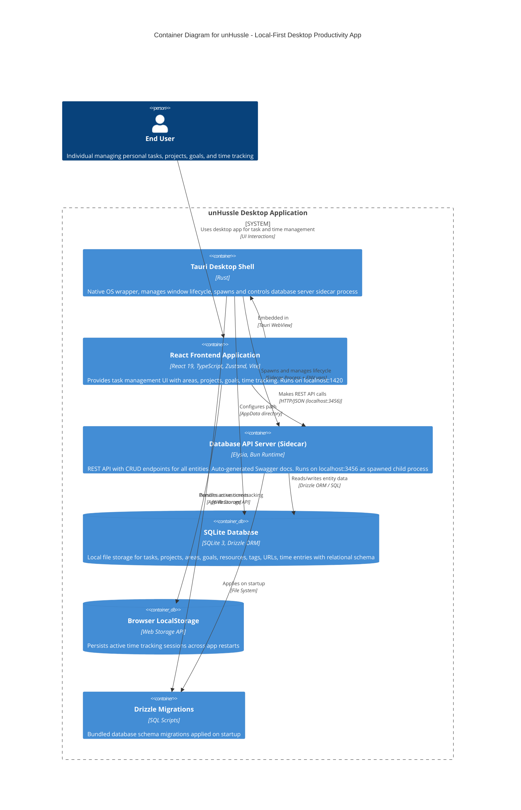

## Architecture Overview
unHussle uses a sophisticated sidecar architecture where:

- A Tauri desktop shell wraps a React frontend
- The Tauri app spawns a local Elysia API server as a child process
- All data is stored in a local SQLite database
- Completely offline-capable - no external dependencies

## C4 Container Diagram



## Key Architectural Insights
1. Sidecar Architecture Pattern
- The Tauri shell spawns the db-server binary as a child process on app startup
- Database path and migrations directory passed via environment variables
- Graceful shutdown with SIGTERM when app closes
- Stdout/stderr captured for logging
2. Local-First Design
- No external APIs or cloud services - completely offline
- SQLite database stored in OS-specific app data directory
- All business logic runs locally on user's machine
- Data never leaves the device
3. Communication Flow
```pre
User → React UI → Zustand Store → Entity Service → 
HTTP REST (localhost:3456) → Elysia API → 
Drizzle ORM → SQLite Database
```
4. Technology Stack
- Frontend: React 19, TypeScript, Zustand (state), Vite (build)
- Backend: Elysia (REST API), Bun (runtime), TypeBox (validation)
- Database: SQLite 3, Drizzle ORM, prepared statements
- Desktop: Tauri 2.0 (Rust), native OS integration
- API Design: Generic route generator with consistent CRUD patterns
5. Data Model
- Entities: Tasks, Resources
- Collections: Areas, Goals, Projects (organizational containers)
- Supporters: Tags, URLs, Time Entries (metadata/attachments)
- Relationships: Many-to-many via junction tables
6. Special Features
- Time Tracking: Client-side service using localStorage for persistence
- Health Monitoring: Frontend polls /health endpoint to verify DB connectivity
- Auto-generated API Docs: Swagger UI at localhost:3456/api
- gzip Compression: All API responses compressed
- Database Seeding: Sample data populated on first run

## Container Breakdown

| Container | Technology | Port | Purpose |
|-----------|------------|------|---------|
| Tauri Desktop Shell | Rust | N/A | OS wrapper, sidecar lifecycle management |
| React Frontend | React 19 + TypeScript | 1420 | User interface and client-side logic |
| Database API Server | Elysia + Bun | 3456 | REST API with CRUD endpoints |
| SQLite Database | SQLite 3 + Drizzle | N/A | Local data persistence |
| LocalStorage | Browser API | N/A | Active time tracking sessions |
| Drizzle Migrations | SQL Scripts | N/A | Schema versioning |

This architecture represents a modern local-first desktop application that prioritizes user privacy, offline capability, and data ownership while maintaining the polish and features of cloud-based productivity tools.
